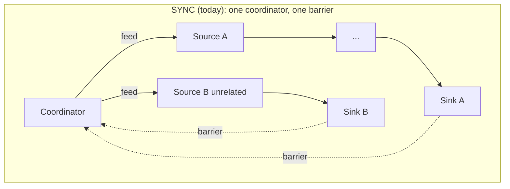
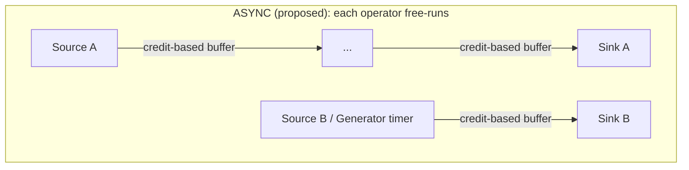

# Proposal: An Asynchronous Dataflow Executor

Companion to [EXECUTOR.md](EXECUTOR.md), which describes today's executor as a
**synchronous, single-superstep (BSP/Pregel) dataflow engine**. This document
proposes a second, **asynchronous dataflow** execution model, what it would
take to build (spec vs. implementation), and how it should be exposed to
end users. It reuses the terminology and file references established in
EXECUTOR.md throughout.

## Why: what BSP gives up

EXECUTOR.md's "Known constraints" section already names the core issue: one
coordinator, one round-scoped barrier, one shared clock. Two concrete cases
motivate an async model:

1. **Independent branches sharing a graph** — a heartbeat/stats `Generator`
   with no data edges to a hot ETL branch still throttles that branch today,
   because both branches' sinks are drained by the same barrier every round.
2. **Genuine asynchronous fan-in at a shared operator** — e.g. a
   session-window operator that should flush either when new data arrives
   *or* when an idle timer elapses, whichever comes first. Today's edges are
   pure rendezvous barriers (`<-edge.Out()` discards its value and exists
   purely to synchronize); there is no way for an operator to react to
   "whichever upstream signals first."

## Target model, in well-known terms

Move from **BSP/Pregel synchronous supersteps** to **continuous
asynchronous dataflow**, the model used by Flink, Beam (on a streaming
runner), Kafka Streams, and Akka/Pekko Streams. The mapping:

| Concept (this proposal)                 | Established term                                        |
|------------------------------------------|----------------------------------------------------------|
| Each operator scheduled independently    | Per-**Task**/subtask scheduling (Flink); no global superstep |
| Edge becomes a bounded, buffered channel  | **Network buffer** with **credit-based flow control** (Flink) |
| Overflow policy per edge                  | **Conflation** ("latest value wins") vs. **bounded FIFO with backpressure** — analogous to Reactive Streams `request(n)` demand signaling, or a "hot" vs. "cold" observable in Rx |
| Per-stream progress/completion marker     | **Watermark** — here used primarily for *completion* (a stream's watermark reaching `+inf` ⇔ EOF), with headroom to later support event-time windowing |
| Operator-owned scheduled callbacks        | **Timers** (event-time or processing-time), first-class, not a special-cased `Generator` operator type |
| Whole-graph termination                   | **Distributed termination detection** / quiescence (Dijkstra–Scholten style: done when every source is closed *and* every in-flight edge/operator is idle) |
| Self-scoped state rotation                | Operator-local **state backend** commit, decoupled from any global epoch |





## What has to change: implementation-only vs. spec

The good news: the CEL layer is almost entirely orthogonal to this change.
Parse → Compile → Run ([EXECUTOR.md](EXECUTOR.md#operator-lifecycle-parse--compile--run)),
lazy pull-based `Activation` evaluation, and the `Runtime_EOF`/`Done`/`Skip`
sentinels all keep working unmodified — they're properties of a single
operator's evaluation, not of the scheduler. What changes lives almost
entirely in `shared/exec.go` and `shared/edge.go`. Per-operator `prev`/`curr`
rotation is already **self-triggered** today (see EXECUTOR.md's
[State](EXECUTOR.md#state-bounded-depth-1-state--lazy-pull-evaluation)
section) — that used to be a Phase 2 item on its own, but it landed as part
of a correctness fix to the SYNC executor (rotation was previously,
incorrectly, scoped to sink/end operators only), so Phase 2 inherits it for
free and doesn't need to revisit it.

### Phase 1 — implementation-only, ships as a default improvement

**No spec change.** Partition the graph into **weakly-connected components**
(the adjacency data already computed by `Graph.computePreds`,
[graph.go](../graph.go#L314-L327)) and run one independent `runControlFlow`
coordinator per component instead of one global coordinator. A fully
connected flow (the overwhelming common case — one component) behaves
**exactly as it does today, byte-for-byte** — this is a strict refinement,
not a behavior change, so it's safe to ship unconditionally rather than
gating it behind an opt-in.

This alone solves motivating case 1 above (independent heartbeat/stats
branches) with no spec surface at all — it's "static task-parallelism"
applied to a graph that was already logically disconnected; we're just
stopping the executor from pretending otherwise.

It does **not** solve motivating case 2 (async fan-in at a shared operator)
— that requires the full model below, because the branches genuinely share
an operator and must be reconciled at that operator, not just decoupled from
each other.

### Phase 2 — the full async model, needs both spec and implementation changes

**Implementation changes** (all confined to `shared`, no change to `impl`
operator logic or CEL semantics):

- **`shared.Edge`**: replace the zero-buffer rendezvous channel with a small
  bounded buffer and an explicit overflow policy (`Block` | `DropOldest` |
  `Conflate`). This is the credit-based/backpressure primitive.
- **`Executor.runControlFlow`**: remove the collective start/end barrier;
  each source operator's `runNodeFlow` free-runs on its own tick (data
  arrival or timer), each sink commits independently. What remains of the
  "coordinator" is a **termination detector**, not a scheduler — see below.
- ~~`Node.Reset()` becomes self-triggered~~ — **already done.** Rotation of
  `curr → prev` (`setPending`/`setValue` in
  [node.go](../../v1beta1/runtime/node.go#L174-L196)) is already self-triggered
  per operator, immediately before that operator produces its next result,
  rather than via a global, round-scoped sweep. Phase 2 doesn't need to
  change this mechanism at all — see
  [Consistency trade-off](#the-consistency-trade-off) below for why it's
  still effectively round-scoped under SYNC today, and what Phase 2 actually
  changes.
- **Termination detection**: replace the "scan for a `Runtime_Done` value"
  check with quiescence detection — a component is finished once every
  source has signaled EOF *and* there are zero in-flight elements anywhere
  in that component (a simple inflight counter incremented on send,
  decremented on downstream commit, is sufficient — the same technique Beam
  uses to advance a bundle's watermark to `+inf`).
- **Timers as a first-class primitive**: today's `Generator` becomes one
  particular use of a general per-operator timer API, so any operator
  (not just a dedicated `Stream.Generator`) can register a processing-time
  or event-time callback without needing the global coordinator to drive it.

**Spec changes** — only one is actually required to ship Phase 2; the rest
are optional, additive, and deferrable:

1. **Required: an execution-mode declaration on `Flow`.** This has to be a
   spec/proto field, not just a Go `ExecutorOption`, because it's a
   user-facing, persisted choice that needs to round-trip through storage,
   the JSON Schema used by the YAML editor, and the CLI — not something only
   decided at `Executor.Run` call time.

   ```proto
   message Flow {
     ...
     enum ExecutionMode {
       EXECUTION_MODE_UNSPECIFIED = 0; // defaults to SYNC
       EXECUTION_MODE_SYNC = 1;
       EXECUTION_MODE_ASYNC = 2;
     }
     ExecutionMode execution_mode = 12;
   }
   ```

   ```yaml
   apiVersion: v1beta1
   kind: Flow
   spec:
     name: write-table-from-csv
     executionMode: ASYNC   # optional; SYNC (today's behavior) is the default
   ```

2. **Optional, deferrable — per-edge buffer/overflow policy.** Only useful
   once real workloads need to tune it; ship with a sane default
   (bounded FIFO, capacity 1, `Block`) and add this later without breaking
   anything:

   ```proto
   message Stream {
     ...
     message Buffer {
       uint32 capacity = 1;
       enum OverflowPolicy {
         OVERFLOW_POLICY_UNSPECIFIED = 0; // Block (default)
         OVERFLOW_POLICY_BLOCK = 1;
         OVERFLOW_POLICY_DROP_OLDEST = 2;
         OVERFLOW_POLICY_CONFLATE = 3;
       }
       OverflowPolicy overflow_policy = 2;
     }
     Buffer buffer = 8; // only meaningful when the Flow is ASYNC
   }
   ```

3. **Optional, future — watermark/idle-timeout configuration** for true
   session-window triggers (flush-on-idle-timeout). This is the deferred
   "session windows" work; it composes naturally on top of Phase 2's
   watermark/timer primitives but isn't needed to ship async execution
   itself.

### The consistency trade-off

This needs to be called out on its own, since it's the one place the async
model is strictly weaker than today's guarantees, not just differently
scheduled. Under SYNC, each operator's own `curr → prev` rotation is already
self-triggered (same mechanism proposed for ASYNC above) — what makes it
*effectively* round-scoped and global today is only the shared round barrier:
because every operator is forced to produce at most once per round before the
next round starts, every operator's `self.prev` refers to *exactly* "the value
from the previous completed round," and every operator downstream of another
in the same round sees a value that was frozen for that entire round. Under
ASYNC, there is no barrier — `self.prev` still means "the last value *this*
operator itself produced" (that guarantee is per-operator, self-triggered,
and survives unchanged), but a CEL expression reading a *different*
operator's `.value` may observe it mid-flight relative to its own producer's
cadence — i.e. **latest-known-value / eventual-consistency semantics**, the
same trade-off Reactive Streams and Flink's async I/O operators make. In
other words, Phase 2 doesn't change *how* rotation happens, only removes the
barrier that currently makes it round-aligned. Flows that lean on exact
round-alignment across branches (rather than each operator's own
`self.prev`) need to be re-examined before being switched to ASYNC — this is
worth a lint/validator warning in the future, not a hard block.

## Should both models be supported?

Yes, with **SYNC remaining the default**:

- **Zero behavior change for existing flows.** Every flow written today
  (and every existing test) assumes round-aligned, exactly-once-per-round
  semantics. Making ASYNC opt-in means Phase 1 ships as a pure improvement
  and Phase 2 ships with no risk to anything that doesn't ask for it.
- **Most flows don't need it.** A straight-line ETL like
  `write-table-from-csv.yaml` gains nothing from async scheduling — SYNC's
  simplicity (trivial reasoning, free backpressure, no torn cross-operator
  reads) is a genuine feature, not just a limitation, and should stay the
  default posture.
- **Async is for a specific, identifiable class of flows** — independent
  timer/heartbeat branches (solved for free by Phase 1) and genuine
  async fan-in at a shared operator (Phase 2) — so it should be
  something an author *opts into*, having accepted the consistency
  trade-off above, not something silently inferred from graph shape.

## How an end user declares it

**At the `Flow` level**, via the `executionMode` field proposed above —
not per-stream/per-operator. Reasons for this granularity, not finer:

- It matches the executor's actual unit of execution today (`Executor.Run`
  operates on one `Graph` per `Flow`); a mixed-mode single graph would
  require every operator, edge, and the coordinator itself to branch on a
  per-node flag, multiplying the implementation and testing surface for a
  benefit (partial async within one flow) that Phase 1's automatic
  component-partitioning already covers in the most common shape of that
  request (a disconnected branch).
- It's the smallest declaration that still needs to be a spec field (per
  the reasoning above — it must persist and round-trip), keeping the v1
  surface area minimal: one enum, default `SYNC`, explicit `ASYNC` opt-in.
- It leaves room to grow: if a real use case later demands mixed-mode
  within one flow (e.g. one branch wanting `Buffer.overflow_policy:
  CONFLATE` while another wants strict `BLOCK`), that's an additive,
  backward-compatible extension via the optional per-`Stream` `Buffer`
  field from Phase 2 — it doesn't require revisiting the top-level
  `executionMode` decision.

```yaml
apiVersion: v1beta1
kind: Flow
spec:
  name: write-table-from-csv
  executionMode: SYNC   # default; omit entirely for identical behavior to today
```

```yaml
apiVersion: v1beta1
kind: Flow
spec:
  name: ingest-with-heartbeat
  executionMode: ASYNC  # opts into Phase 2 semantics for this whole flow
  streams:
    - id: heartbeat
      buffer:
        capacity: 1
        overflowPolicy: CONFLATE   # timer ticks: only the latest matters
      generate:
        every: 5s
    - id: rows
      buffer:
        capacity: 16
        overflowPolicy: BLOCK      # every row matters — apply backpressure
      call: { ... }
```

## Summary

| | Phase 1 (component partitioning) | Phase 2 (full async dataflow) |
|---|---|---|
| Spec change | None | `Flow.executionMode` (required); `Stream.buffer` (optional) |
| Implementation change | `Executor.runControlFlow` partitioned per weakly-connected component | `shared.Edge` buffering, barrier removal, quiescence-based termination, first-class timers (self-scoped state rotation already lands in Phase 1's baseline) |
| Backward compatible? | Yes — strictly a no-op for single-component flows | Yes — gated behind explicit `executionMode: ASYNC` |
| Solves independent timer/heartbeat branches | Yes | Yes (subsumes Phase 1's benefit) |
| Solves async fan-in at a shared operator (session windows, etc.) | No | Yes |
| Consistency guarantee | Unchanged (still round-aligned) | Weaker across operators (latest-known-value); unchanged for an operator's own `self.prev` |

Recommendation: ship Phase 1 unconditionally now (it's a strict
improvement with no spec surface), and treat Phase 2 as the actual "async
executor" proposal — gated behind `executionMode: ASYNC` — to take up only
once there's a concrete use case needing real async fan-in (e.g. true
session-window triggers), since it's the piece that both costs the most to
build and changes what guarantees an author can rely on.
