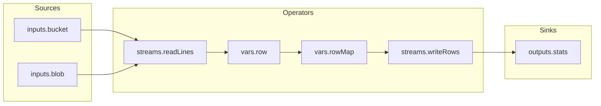
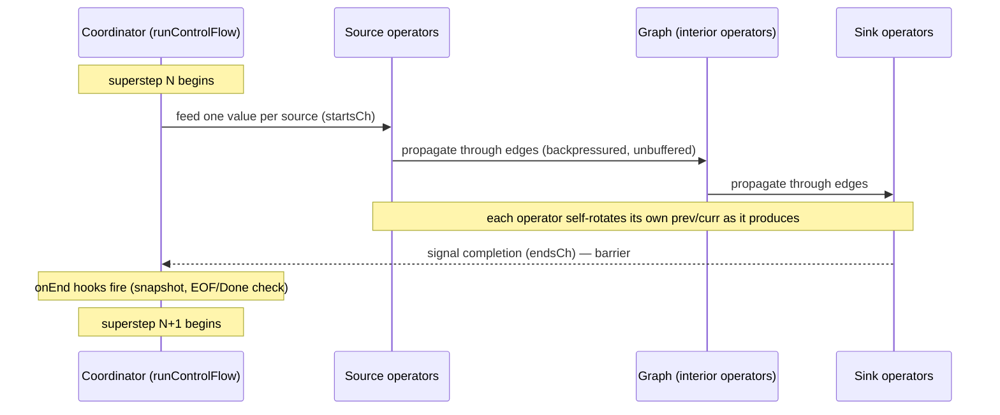

# Executor Architecture Overview

This document describes the `shared.Executor` / `shared.Graph` engine (and its
`runtime` package wiring) using terminology familiar from mainstream stream
processing systems (Flink, Beam, Pregel/BSP graph engines, Reactive Streams),
to make the design's guarantees — and its current limits — explicit.

## TL;DR

The executor is a **synchronous, single-superstep (BSP) dataflow engine**: the
Flow spec compiles to a **DAG of operators** connected by **zero-buffer
(rendezvous) streams**. Every *source* operator is driven in lockstep with
every *sink* operator once per **round** (superstep); the round only advances
once all sinks have produced a result. This gives strong, easy-to-reason-about
semantics (exactly-one-value-per-operator-per-round, natural backpressure, no
unbounded buffering) at the cost of independent operator scheduling — it is
closer to **Pregel/BSP graph processing** than to a fully asynchronous
dataflow runtime like Flink or Beam.

## Glossary: internal name → stream processing term

| Internal (`shared`/`runtime`)         | Stream processing term                         | Role |
|----------------------------------------|-------------------------------------------------|------|
| `shared.Graph[T]`                      | Dataflow DAG / execution plan                    | Topology of operators + streams, built once, immutable at run time |
| `shared.Node` / `runtime.Node`         | Operator (a la Flink `Operator`/Beam `DoFn`)     | Unit of computation with typed input/output ports |
| `shared.Edge`                          | Stream / channel                                 | Zero-buffer, backpressured link between two operators |
| start node (`len(inbound) == 0`)       | Source operator                                  | `inputs.*`, `connections.*`, generator streams |
| end node (`len(outbound) == 0`)        | Sink operator                                    | `outputs.*` (typically) |
| `Executor.runControlFlow`              | Job coordinator / superstep driver (Pregel "master") | Drives round boundaries, invokes lifecycle hooks |
| one iteration of `runControlFlow`      | Superstep / round / epoch                        | One synchronous pass: feed sources → run graph → drain sinks |
| `startsCh` / `endsCh` fan-out/fan-in   | Superstep barrier                                | All sources fed and all sinks drained before advancing |
| `Node.Run` (`ExecFunc`/`Pipe.Run`)      | Operator's user function (`process()`/`DoFn.ProcessElement`) | Domain logic: CEL eval, RPC call, generator tick, window buffer |
| `runNodeFlow`                          | Operator's input gate / output collector          | Bridges the operator's `Send`/`Recv` ports to graph edges |
| `Node.Value()` + self-triggered `prev`/`curr` rotation | Bounded (depth-1) operator state / `ValueState` | Backs the `self.prev` accumulator pattern |
| `Runtime_EOF` sentinel                 | Stream completion marker (a la a "poison pill"/close signal) | Set on a node when its source stream is exhausted |
| `Runtime_Done`                         | Job/pipeline termination signal                  | Detected by `Executor.IsDone`, cancels the whole run |
| `Runtime_Skip`                         | Filtered/no-op element                           | Suppresses propagation without ending the stream |
| CEL `Activation` lazy `func() ref.Val` | Pull-based / demand-driven evaluation             | A node's value is only computed if actually dereferenced |
| `Graph.Visitor` (CEL AST walk)         | Automatic lineage/dependency inference             | Edges are *derived* from expressions, never hand-wired |

## The DAG: operators and streams

Every Flow node (`connections.*`, `inputs.*`, `vars.*`, `streams.*`,
`actions.*`, `outputs.*`) becomes one **operator** (`shared.Node`) in a single
DAG (`shared.Graph[T]`). There is no explicit topology in the spec — **edges
are inferred** by statically walking each node's parsed CEL expression AST
(`Graph.Visitor` in [graph.go](../graph.go#L154-L173)) and recording a stream
whenever one node's expression selects another node's identifier
(`vars.rowCount.value` → edge `vars.rowCount -> vars.stats`). This is
equivalent to automatic **lineage/dependency extraction** in a query planner —
the author writes expressions, not wiring.

Edges carry no application payload of their own — they are pure
**synchronization signals** (an unbuffered `chan any`, see
[edge.go](../edge.go#L18-L26)). The actual value referenced by a downstream
expression is pulled directly out of the upstream operator's state
(`Node.Value()`) through the CEL `Activation`, not through the edge. The edge
only guarantees *"the upstream operator has finished producing for this
round"* before the downstream operator is allowed to read.

Topology constraints are enforced like a stream-DSL type system:
`invalidEdges` in [edge.go](../edge.go#L9-L16) forbids, e.g., a `connections.*`
or `outputs.*` node from feeding an `actions.*`/`streams.*`/`vars.*` node —
analogous to disallowing a sink from being used as a source in a well-typed
dataflow graph.

## The superstep (BSP round)

`Executor.runControlFlow` ([exec.go](../exec.go#L179-L227)) is the single
coordinator loop, playing the role of a Pregel "master"/Flink JobManager. Each
iteration is one **synchronous superstep**:

Concretely, per round:

1. **Feed sources** — `onInit`/`onStarts` compute one value per source operator
   (a "watermark"-free tick — e.g. re-reading cached inputs, or ticking a
   generator), then the coordinator sends it into that operator's `startsCh`.
2. **Propagate** — every operator concurrently runs its own
   `runNodeFlow` goroutine, which blocks until its upstream edges have all
   signalled, forwards the value pair through the operator's `Send`/`Recv`
   ports (invoking the operator's actual logic), then signals its own
   downstream edges (or the sink barrier).
3. **Barrier at sinks** — the coordinator sequentially awaits **every** sink's
   `endsCh`. The round cannot advance until all sinks have produced —
   this is the exact analogue of a Chandy-Lamport/Flink checkpoint barrier,
   except used here purely to delimit round boundaries rather than for
   snapshotting.
4. **`onEnd` hooks** — after the barrier, [exec.go](../../v1beta1/runtime/exec.go#L83-L98)
   wires: (a) take a snapshot of the whole `Env`, (b) check `Executor.IsDone`
   (any operator holding a terminal `Runtime_Done`) and cancel the run if so.

State rotation (`curr → prev`) is **not** part of this barrier/`onEnd` step at
all — it is **self-triggered per operator**, immediately before that operator
computes its next result: `setPending` ([node.go](../../v1beta1/runtime/node.go#L174-L184))
rotates the proto-level result the instant a new round starts for that
operator (before its `StartTime` is overwritten, since that's the last moment
`ResultCurr` still holds a complete, untouched snapshot of the prior round),
and `setValue` ([node.go](../../v1beta1/runtime/node.go#L189-L196)) rotates
the Go-level `prev`/`curr` pair the instant the operator's new value is about
to be recorded. Because the round barrier still only lets an operator produce
once per round, this delivers the same net guarantee a global reset would —
`self.prev` == exactly the previous round's value — but now uniformly for
**every** operator, not just sinks. (An earlier version of this executor
mistakenly scoped rotation to sink/end nodes only via a global
`Nodes.Reset()` sweep in `onEnd`, which silently broke `self.prev`
accumulators on any interior, non-sink operator — this has since been fixed
by making rotation self-triggered.)

## Operator lifecycle: Parse → Compile → Run

Operators go through three phases, mirroring the **logical plan → physical
plan → execution** split common to query engines and Beam's
pipeline-construction-vs-execution separation:

- **Parse** (`GraphNode.ParseExpr`, [graph.go](../../v1beta1/runtime/graph.go#L218-L249)):
  CEL expressions are parsed into an AST; the AST walk simultaneously derives
  the operator's inbound edges (dependency inference, see above). Produces a
  `google.api.expr.v1alpha1.ParsedExpr` cached on the node's proto.
- **Compile** (`GraphNode.CompileExpr`/`Compile`,
  [graph.go](../../v1beta1/runtime/graph.go#L253-L297)): the AST is type-checked
  against the node's scoped CEL `Env` and turned into a runnable
  `cel.Program`. This is where a bad reference (e.g. the unquoted map-literal
  key bug) would be caught — a compile-time (not run-time) failure.
- **Run** (`Node.Run`, [node.go](../../v1beta1/runtime/node.go#L138-L147)): the
  steady-state, per-round execution of the operator's business logic (a CEL
  eval for a `Var`, an RPC call for a `MethodCall` stream, a `time.After` tick
  for a `Generator`, buffer management for a `Window`).

Each operator carries **its own scoped `Env`** (`GraphNode` embeds `*Env`,
extended per node via `env.extend(...)` in
[graph.go](../../v1beta1/runtime/graph.go#L182-L188)) rather than being handed a
shared environment reference at call time. This eliminates an entire class of
"wrong environment captured in a closure" bugs by construction — every
operator's evaluation context is a value it owns, not something threaded
through a loop variable.

## Streams as backpressured, zero-buffer channels

Every channel in the system — `Node.Send()`/`Recv()`, `Edge.In()`/`Out()`,
`startsCh`/`endsCh` — is an **unbuffered** `chan any`. There is no queueing
capacity anywhere in the data plane. This means:

- A producer cannot get more than one element "ahead" of its slowest
  consumer — the rendezvous handoff *is* the backpressure mechanism, similar
  to Reactive Streams' demand-then-produce model collapsed to a demand of
  exactly 1.
- There is no possibility of unbounded memory growth from a fast producer
  outpacing a slow consumer — the producer simply blocks.
- The cost of this simplicity is global coupling: because nothing buffers,
  the *slowest* operator in a round determines that round's latency for
  *every* operator sharing the round (see below).

## State: bounded depth-1 state + lazy pull evaluation

Each operator holds exactly two historical values — `curr` (this round's
result) and `prev` (last round's result). Rotation is **self-triggered**: an
operator rotates its own `curr → prev` (and the equivalent proto-level
`ResultCurr`/`ResultPrev`) the moment it starts producing a new result,
in `setPending` and `setValue`
([node.go](../../v1beta1/runtime/node.go#L174-L196)) — there is no separate,
externally-invoked "reset" step. This is a deliberately minimal state backend
(compare to Flink's arbitrary `ValueState`/`ListState`): just enough to
implement **accumulator patterns** in user CEL expressions via `self.prev`,
without the engine needing a general keyed-state store.

Access to this state is **pull-based and lazy**: a node's value is exposed to
CEL as a `func() ref.Val` thunk in the `Activation`
([env.go](../../v1beta1/runtime/env.go#L132), `Node.Vars`
[node.go](../../v1beta1/runtime/node.go#L92-L107)). cel-go only invokes that
thunk if the identifier is actually resolved during evaluation, and a
non-strict/short-circuiting ternary (`cond ? a : b`) only walks the taken
branch's subtree — so an untaken branch's node values are never computed for
that round. This is effectively **demand-driven evaluation**, the same
principle behind dataflow/reactive languages and query engines that avoid
computing columns/operators nobody asked for.

## Termination semantics: EOF, Done, Skip

Three sentinel proto messages act like well-known stream control signals:

- **`Runtime_EOF`** — set on a node when its `Run` returns an error satisfying
  `errors.Is(err, io.EOF)` ([node.go](../../v1beta1/runtime/node.go#L272-L295)).
  This is a **per-operator, per-stream completion marker** (closer to a
  "close" signal on one input than a global watermark) — downstream
  expressions detect it via `isEOF(...)` and can react (e.g. stop
  incrementing a counter, flush a final snapshot).
- **`Runtime_Done`** — a **whole-run termination signal**. `Executor.IsDone`
  ([exec.go](../../v1beta1/runtime/exec.go#L111-L127)) scans all operators every
  round; if any holds a `Done`, the run's `context` is cancelled with that
  cause (a `Done{is_error: true}` is prioritized over a clean one, so the
  first hard error found wins). This is the closest analogue to a Flink job
  reaching `FINISHED`/`FAILED`.
- **`Runtime_Skip`** — a filtered/no-op element: the operator ran but
  produced nothing meaningful for this round, without ending the stream.

## Known constraints vs. a full async dataflow engine

Because there is exactly **one** coordinator loop and **one** shared round
barrier, *every* source/sink in the graph advances at the same cadence. A
`Generator` operator ticking every 5s and a hot CSV-row loop in the
**same graph** would force the entire graph down to one round per 5s, even
though the two branches have no data dependency on each other — the barrier
at the sink set doesn't distinguish "this branch is slow" from "this branch
is unrelated." This is the classic BSP/Pregel trade-off (global synchronous
supersteps are easy to reason about, but couple otherwise-independent work),
as opposed to Flink/Beam's per-operator async scheduling with buffered,
credit-based channels between disconnected subgraphs.

Two concrete implications this doc's readers should keep in mind:

1. **Purely CEL-computed periodic behavior is free.** A `self.prev` +
   `now()` + `isEOF()` accumulator evaluated *inside* an already-hot operator
   (see `write-table-from-csv.yaml`'s `vars.stats`) adds no new operator to
   the round loop and therefore no coupling — it's just an extra cheap
   comparison per round.
2. **A genuinely independent timer/heartbeat *operator*** (a `Generator`
   with no data edges to the hot branch) *would* throttle the whole graph
   under the current single-superstep coordinator, because both branches'
   sinks are drained by the same barrier each round. Decoupling this
   properly requires either (a) partitioning the coordinator per
   weakly-connected component of the DAG (a scoped, moderate change), or
   (b) moving edges to a non-blocking/latest-value model for genuine
   asynchronous fan-in at a shared operator (a larger change to the edge
   contract that every existing flow currently depends on for its
   once-per-round guarantees).
